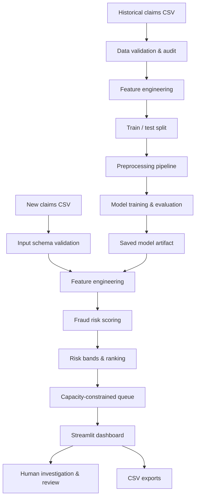

# Insurance Claim Fraud Detection & Investigation Prioritization

> **Portfolio project | Machine Learning | Risk Ranking | Streamlit | Human-in-the-loop decision support**
>
> This project is an educational prototype that scores motor-insurance claims for potential fraud risk and prioritizes a limited number of claims for human investigation. It is **not** an automated claim rejection system, and model scores are not proof of fraud.

**Live Streamlit App:** https://insurance-claim-fraud-detection-eannpyyxuxjquqdvfpshjm.streamlit.app/

---

## 1. Executive summary

Insurance teams may receive more claims than their investigation teams can review. A useful fraud-screening system should therefore do more than classify claims as fraudulent or legitimate: it should **rank claims by risk and help investigators use a finite review capacity**.

This project builds an end-to-end workflow that:

1. Audits a historical claims dataset and explores fraud patterns.
2. Engineers features and removes identifier-like fields from model predictors.
3. Trains and compares baseline and class-imbalance-aware models.
4. Evaluates both threshold-based classification and capacity-constrained ranking.
5. Scores claims, assigns operational risk bands, and creates an investigation queue.
6. Provides a Streamlit dashboard for analytics, queue review, claim-level inspection, and CSV export.

The central operational idea is **Top-K prioritization**: rank all claims by model score and select only the highest-ranked claims up to the investigation capacity. The model supports human review; it does not determine claim outcomes.

## 2. Business problem

### Scenario assumptions

These figures define the portfolio case study and are assumptions—not verified insurer operating data:

| Assumption | Value |
|---|---:|
| Claims received per month | 10,000 |
| Historical fraud prevalence used for scenario | ~6% |
| Investigation capacity | 200 claims/month |
| Cost per investigation | ₹2,000 |
| Average fraudulent claim payout (assumption) | ₹50,000 |

### Problem statement

> Develop an ML-assisted fraud-risk ranking system that identifies the highest-risk claims for investigation within a fixed monthly capacity of 200 claims, with the goal of improving fraud detection efficiency while minimizing unnecessary investigation of legitimate claims and protecting customer experience.

### KPI hierarchy

**Primary operational metric**
- **Precision@K** — proportion of claims in the selected investigation queue that are fraudulent in the labeled evaluation data, where K is the available investigation capacity (scaled to the test split for evaluation).

**Secondary metrics**
- Recall@K — proportion of all fraud cases captured within the selected queue.
- Average Precision / PR-AUC — ranking quality under class imbalance.
- ROC-AUC — overall discrimination, interpreted alongside PR-AUC.
- Precision, recall, F1 and confusion matrix at a chosen classification threshold.

**Business and customer guardrails (not yet measured in this dataset)**
- Investigation workload and cost.
- Confirmed fraud value identified.
- Estimated net savings / ROI after investigation costs.
- Claim processing delays, customer complaints and false-positive burden.
- Fairness and disparate impact across relevant customer groups.

## 3. Dataset

- **File:** `data/raw/fraud_oracle.csv`
- **Dataset description:** Historical vehicle/motor insurance claim records with a binary fraud label.
- **Rows:** 15,420
- **Columns:** 33
- **Fraud cases:** 923
- **Non-fraud cases:** 14,497
- **Fraud prevalence:** 5.99% (approximately 6%)
- **Missing cells in the raw file:** 0
- **Duplicate rows:** 0

The project archive identifies the source as a Kaggle dataset but does not record a canonical dataset URL or author citation. **Add the exact source URL and dataset license/terms to this section before public release.**

The data is historical and is intended for learning and portfolio demonstration. It should not be assumed to represent current insurance products, fraud behavior, claims processes, population distributions, or regulatory conditions.

### Target and identifier handling

- Target: `FraudFound_P`
- Identifier-like fields excluded from model predictors: `PolicyNumber`, `RepNumber`
- If the target column is present in an uploaded file, it is removed before model scoring and used only for retrospective analysis in the dashboard.

## 4. Solution architecture



### Main components

| Component | Responsibility |
|---|---|
| `notebooks/` | Exploratory work, experiments, model evaluation and explainability |
| `src/data_processing.py` | Dataset loading, schema validation, target separation and audit summary |
| `src/feature_engineering.py` | Reusable feature transformations shared by training and scoring |
| `src/train.py` | Build preprocessing/model pipeline, train, evaluate and save model/report |
| `src/predict.py` | Load model, validate inference data, score claims and create risk bands |
| `src/risk_engine.py` | Rank scores, calculate capacity, assign priority and export queue |
| `app/dashboard.py` | Streamlit dashboard for analytics, worklist, claim review and exports |
| `tests/test_pipeline.py` | Unit/integration checks for schema, features, scoring and queue logic |

## 5. Exploratory analysis and feature engineering

The notebooks examine target prevalence and fraud-rate associations across categorical and numerical fields. Observed patterns are exploratory; they are not causal explanations or rules for treating an individual claim.

### Engineered features

The feature-engineering module adds 12 features:

- `AgeGroup`
- `AccidentClaimMonthMismatch`
- `AccidentClaimDayMismatch`
- `VehicleAgeYearsOrdinal`
- `PastClaimsOrdinal`
- `SupplementCountOrdinal`
- `DaysPolicyAccidentOrdinal`
- `DaysPolicyClaimOrdinal`
- `AddressChangeYearsOrdinal`
- `AddressChangedFlag`
- `VehiclePriceOrdinal`
- `NumberOfCarsOrdinal`

The pipeline also normalizes historical placeholder values in claimed date fields. Ordinal mappings represent approximate order or midpoint values for grouped categories; they are modeling conveniences and should not be interpreted as exact measurements.

### Leakage and preprocessing controls

- `FraudFound_P` is excluded from model predictors.
- `PolicyNumber` and `RepNumber` are dropped from predictors.
- Train/test splitting is stratified by target.
- Imputation, scaling and one-hot encoding are fit within the training pipeline.
- `OneHotEncoder(handle_unknown="ignore")` supports unseen categories at inference.
- Feature schema is aligned to metadata saved with the model artifact.

## 6. Modeling approach

Three model configurations were compared in Notebook 05:

1. Logistic Regression baseline.
2. Logistic Regression with class weighting.
3. Random Forest with class weighting.

The reusable training script uses:

- **Model:** `RandomForestClassifier`
- **Trees:** 100
- **Class weight:** `balanced_subsample`
- **Minimum samples per leaf:** 2
- **Random state:** 42
- **Preprocessing:** numeric median imputation + scaling; categorical most-frequent imputation + one-hot encoding
- **Split:** stratified 80/20 train/test split

The model artifact includes the fitted preprocessing/model pipeline and training metadata.

## 7. Model results

### Reusable training pipeline — held-out test set

Results from the current `reports/training_report.json` artifact:

| Metric | Result |
|---|---:|
| Test rows | 3,084 |
| Test fraud cases | 185 |
| Test fraud prevalence | 6.00% |
| Accuracy at 0.50 threshold | 94.07% |
| Precision at 0.50 threshold | 56.25% |
| Recall at 0.50 threshold | 4.86% |
| F1 at 0.50 threshold | 8.96% |
| ROC-AUC | 0.8302 |
| Average Precision (PR-AUC summary) | 0.2369 |
| True positives at 0.50 threshold | 9 |
| False positives at 0.50 threshold | 7 |
| False negatives at 0.50 threshold | 176 |
| True negatives at 0.50 threshold | 2,892 |

**Interpretation:** Accuracy is high largely because legitimate claims dominate the dataset. At the default 0.50 classification threshold, the model identifies only a small fraction of fraud cases. Accuracy alone is therefore not a useful success criterion for this problem.

### Capacity-aligned test evaluation

The full-population scenario uses capacity 200 for 15,420 claims. The held-out test set is approximately 20% of the population, so its capacity is scaled to **K = 40** for a comparable ranking evaluation.

| Metric | Result |
|---|---:|
| Test-set investigation capacity (K) | 40 |
| Fraud cases in Top-40 | 16 |
| Precision@40 | 40.00% |
| Recall@40 | 8.65% |
| Random-selection precision baseline | ~6.00% |
| Precision lift vs random | ~6.67× |

This means 16 of the 185 fraud cases in the test set were present in the highest-risk 40 claims. This is a useful ranking improvement over random selection, but Recall@40 remains low and must not be presented as solving fraud detection.

### Notebook model comparison (reported experiment)

| Model | ROC-AUC | Average Precision | Precision@40 | Fraud in Top-40 | Recall@40 |
|---|---:|---:|---:|---:|---:|
| Random Forest (balanced) | 0.8283 | 0.2317 | 40.0% | 16 | 8.65% |
| Logistic Regression (baseline) | 0.8163 | 0.1778 | 20.0% | 8 | 4.32% |
| Logistic Regression (balanced) | 0.8076 | 0.1528 | 15.0% | 6 | 3.24% |

The reusable training script's metrics differ slightly from the notebook comparison because the artifacts reflect separate training/evaluation runs/configuration details. Use the training report as the metrics source for the packaged reusable pipeline and the comparison table as the notebook experiment record.

## 8. Threshold classification vs. capacity ranking

These are two distinct decisions:

- **Threshold classification:** labels a claim as predicted fraud when its score is at or above the selected threshold (default 0.50). Changing this threshold affects the binary `Predicted_Fraud` output.
- **Capacity-based investigation queue:** sorts claims by score and selects the top K claims based on investigation capacity. This selection is independent of the classification threshold.

The dashboard makes this distinction explicit. A claim may be selected for investigation even if its score is below the binary classification threshold, and a threshold may label more claims than investigators can review.

### Risk bands

| Band | Score range |
|---|---|
| Low | <10% |
| Moderate | 10% to <30% |
| High | 30% to <50% |
| Very High | ≥50% |

Operational priority labels are display categories, not validated fraud rules:
- Low: below 10%
- Moderate: 10% to <30%
- High: 30% to <50%
- Critical: ≥50%

## 9. Dashboard

The Streamlit application provides six main areas:

1. **Overview:** claim counts by risk band, selected queue composition, score range and safety reminder.
2. **Risk Analytics:** score distribution, median and percentile, threshold count, risk-band table, and capacity-versus-threshold explanation.
3. **Fraud Patterns:** group-level claim counts and average predicted risk; historical fraud rate is shown only when `FraudFound_P` is present.
4. **Investigation Queue:** filters for priority and risk band, ID search, and a filtered worklist download.
5. **Claim Review:** individual claim score, risk band, priority, queue position and attributes for human review.
6. **Export:** selected queue, all ranked claims and KPI summary CSVs.

Dashboard safety messaging emphasizes that scores are estimates and must not be used as the sole basis for rejecting, delaying or penalizing a claim.

> Add dashboard screenshots to a `docs/images/` folder and embed them here before final portfolio publication.

## 10. Repository structure

```text
insurance-claim-fraud-detection/
├── app/
│   └── dashboard.py
├── data/
│   ├── raw/
│   │   └── fraud_oracle.csv
│   ├── processed/                 # generated model-ready files
│   └── README.md
├── models/
│   ├── fraud_model_pipeline.joblib
│   └── other experimental model artifacts (optional)
├── notebooks/
│   ├── 01_business_understanding.ipynb
│   ├── 02_data_audit.ipynb
│   ├── 02_eda_fraud_patterns.ipynb
│   ├── 03_feature_engineering.ipynb
│   ├── 04_baseline_models.ipynb
│   ├── 05_model_comparison.ipynb
│   ├── 06_threshold_optimization.ipynb
│   └── 07_model_explainability.ipynb
├── reports/                       # analysis outputs and evaluation reports
├── src/
│   ├── data_processing.py
│   ├── feature_engineering.py
│   ├── train.py
│   ├── predict.py
│   └── risk_engine.py
├── tests/
│   └── test_pipeline.py
├── .gitignore
├── requirements.txt
└── README.md
```

## 11. Setup and run locally

### Prerequisites

- Python installed (use a virtual environment).
- Git, if cloning the repository.

### 1) Clone and enter the repository

```bash
git clone <YOUR_REPOSITORY_URL>
cd insurance-claim-fraud-detection
```

### 2) Create and activate a virtual environment

**Windows PowerShell:**
```powershell
python -m venv .venv
.\.venv\Scripts\Activate.ps1
```

**macOS / Linux:**
```bash
python -m venv .venv
source .venv/bin/activate
```

### 3) Install dependencies

```bash
python -m pip install --upgrade pip
pip install -r requirements.txt
```

The serialized model was created with scikit-learn **1.9.1**. Keep that version aligned when loading the committed artifact. Scikit-learn warns that loading pickle/joblib artifacts across versions is not guaranteed to be compatible.

### 4) Train the model (optional if the model artifact is included)

```bash
python -m src.train
```

Custom training options:

```bash
python -m src.train --data data/raw/fraud_oracle.csv --capacity 200 --test-size 0.20 --random-state 42
```

This creates/updates:
- `models/fraud_model_pipeline.joblib`
- `reports/training_report.json`

### 5) Run the dashboard

```bash
streamlit run app/dashboard.py
```

Upload a claims CSV that contains the required raw inference fields. The historical target `FraudFound_P` is optional and is excluded from model inputs if present.

### 6) Score claims from the command line

```bash
python -m src.predict --input data/raw/fraud_oracle.csv --output reports/scored_claims.csv --threshold 0.50
```

### 7) Run tests

```bash
python -m pytest -q
```

The current project test suite contains eight tests covering data loading/schema, target and identifier separation, feature-engineering schema, inference validation, scoring outputs, capacity calculation, queue ranking/selection, and invalid risk-score handling.

## 12. Deployment (Streamlit Community Cloud)

1. Push the repository to GitHub.
2. Ensure `requirements.txt` is present in the repository root.
3. Ensure the model artifact `models/fraud_model_pipeline.joblib` is included in the deployment repository, or arrange for it to be generated/downloaded through a secure, reproducible process.
4. In Streamlit Community Cloud, create a new app from the repository.
5. Set **Main file path** to `app/dashboard.py`.
6. Deploy and test with a small sample CSV first.
7. Do not upload real, confidential claim data to a public demo. Use the historical dataset or synthetic data.

A public dashboard should be considered a demonstration. Do not expose production claim data, customer identifiers, confidential information, or operational endpoints.

## 13. Tests and audit status

Current audit run in the provided project copy:
- **8 tests passed**.
- Python syntax compilation of the dashboard passed.
- The scoring tests emitted scikit-learn version warnings because the audit environment used scikit-learn 1.8.0 while the model artifact was created with 1.9.1. The dependency is pinned in the updated requirements file to reduce this mismatch.

The tests are functional checks, not a full validation of model safety, statistical performance, fairness, robustness or production readiness.

## 14. Limitations and risks

### Data and generalization
- The data is historical and may not reflect current fraud tactics, policy products, economic conditions or claims operations.
- Random stratified train/test splitting is used; a temporal holdout would be more realistic for future deployment.
- No external validation dataset or live prospective pilot is available.
- The test set is relatively small for capacity evaluation; Top-K metrics can vary substantially across splits.

### Model performance
- At the default 0.50 threshold, recall is low.
- Top-K performance is better than random in this experiment but captures only a small proportion of test fraud.
- Model scores are not demonstrated to be calibrated probabilities. “Risk score” is more accurate than “probability of fraud” unless calibration is assessed.
- Feature importance and group associations are descriptive; they do not prove causal relationships or fraud.

### Fairness and responsible use
- The dataset includes demographic attributes such as age, sex and marital status. Their inclusion requires a careful fairness, legal and policy review in any real use case.
- A risk score must not be the sole reason for denying, delaying, reducing or penalizing a claim.
- Human investigators should review evidence, document decisions and use consistent procedures.
- Investigations and outcomes should be monitored for false positives, customer impact and disparate effects.

### Operational readiness
Before any real-world pilot, the system would require:
- Temporal and external validation.
- Probability calibration analysis if scores are interpreted probabilistically.
- Fairness and subgroup performance assessment.
- Data quality, missingness and drift monitoring.
- Investigator feedback and confirmed-outcome labels.
- Explainability at individual claim level, with evidence review.
- Security, access controls, audit logging and data-retention policies.
- A measured financial evaluation that includes investigation cost, fraud recovery/prevention, false-positive costs and customer impacts.

## 15. Future improvements

- Temporal validation and rolling backtests.
- Hyperparameter tuning and broader model benchmarking.
- Calibration (e.g., reliability curve, Brier score) if probability semantics are needed.
- SHAP or local explanation workflow for individual claims, validated for the chosen model.
- Fairness audit and feature-policy review.
- Investigator outcome feedback loop and retraining strategy.
- Data drift / performance monitoring dashboard.
- Cost-sensitive decision analysis and ROI modeling using clearly stated assumptions.
- Improved deployment pipeline, CI tests, environment lock file and model versioning.
- Add dashboard screenshots, source citation and a concise case-study page to the portfolio.

## 16. License, attribution and disclaimer

- Dataset attribution and dataset license/terms should be documented with the exact source URL before redistribution or public deployment.
- The code and model are a portfolio demonstration. Do not use them to make actual insurance decisions without substantial independent validation, governance, legal review and safeguards.
- Risk scores are model estimates—not confirmed fraud.

---

## Portfolio summary

**Problem:** Insurance fraud detection under limited investigation capacity.

**Approach:** Reusable preprocessing and feature engineering, class-imbalance-aware Random Forest, ranking-focused evaluation, a capacity-based risk engine, and a Streamlit decision-support dashboard.

**Result in the held-out test experiment:** Top-40 queue precision of 40.0% versus approximately 6.0% random baseline (about 6.67× lift), capturing 16 fraud cases out of 185 test frauds. The result is promising as a portfolio demonstration but limited by low recall, historical data, and lack of temporal/external validation.
